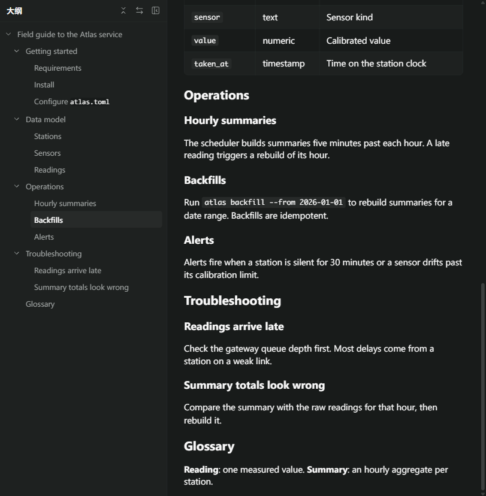

# Markdown Outline for Paseo

A [Paseo](https://paseo.sh) file panel that opens Markdown files with a Typora-style heading outline on the left or right.



- Click a heading to jump to it; the current heading is highlighted while you scroll.
- Collapse and expand sections like a file tree.
- Move the outline left or right, hide it, and pick its width. Choices are saved per device.
- Inline code in headings keeps its styling. Front matter shows as a table. Relative links and images resolve from the file's folder.
- Works in the desktop app, the browser and on phones (the outline opens as an overlay on narrow screens).

See [OVERVIEW.md](OVERVIEW.md) for the full description and limits. 中文说明见 [OVERVIEW.zh-CN.md](OVERVIEW.zh-CN.md)。

## Install

Requires Paseo 0.17.1 or later.

```bash
paseo plugin add git:1099271/paseo-markdown-outline
```

Then open a `.md` file and choose **Markdown with outline** in the viewer picker.

## Develop

```bash
npm install
npm run typecheck
npm test
paseo plugin install "$PWD"
paseo plugin reload markdown-outline
```

`client/document.ts` splits the file into sections at each heading, outside fenced code and HTML comments. Each section renders through Paseo's `Markdown` component, so the panel can scroll to a heading by summing section heights.

## License

MIT
